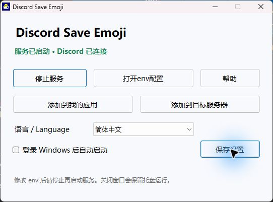
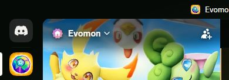

# Discord Save Emoji (DSE)

[简体中文](README.md) · [繁體中文](README.zh-TW.md) · [English](README.en.md)

Save custom emojis from Discord messages and reactions to your own server through the official Apps context menu. No client modification or user-account token.



## Install

Download DSE-Setup-1.0.0-x64.exe from [Releases](https://github.com/ArthurLauCS/DiscordSaveEmoji/releases/latest), install, then double-click the desktop shortcut. Windows 10/11 x64 only; Node.js is included. No administrator access required. No Linux edition. The unsigned installer may show an unknown publisher; verify SHA256 without disabling Windows protections. A startup failure before entering your token is expected.

## 1. Create a Discord app

Create an app in Developer Portal. Enable User Install and Guild Install under Installation. User Install scope: applications.commands. Guild Install scopes: bot + applications.commands; permission: Create Expressions only. Leave privileged intents and Requires OAuth2 Code Grant off, and Interactions Endpoint URL empty.

[Discord Developer Portal](https://discord.com/developers/applications)

## 2. Configure and start

Get the Bot Token from the Bot page (reset it yourself if needed). Click Open env configuration, paste the token after DISCORD_TOKEN=, then save. Do not prefix it with Bot or share it. Normally leave OWNER_ID and TARGET_GUILD_ID empty: the owner is detected automatically and /setup binds the server. Click Start service and wait for connected status.

```dotenv
DISCORD_TOKEN=YOUR_BOT_TOKEN_HERE
TARGET_GUILD_ID=
OWNER_ID=
```

## 3. Install the official app

Once connected, click Add to my apps and Add to target server and complete both Discord authorizations. Choose your own private server as the target. The bot only joins that target. Run /setup in it and wait for the bound confirmation. No browser extension or modified Discord client is required.

## 4. Right-click a message to save

Right-click a message containing custom emojis → Apps → Save Emoji. For multiple emojis, select items then click outside the menu to submit. A single emoji saves immediately. Use the target server’s emoji picker afterward. Menus show at most 25 emojis; repeated saves use extra slots. Stickers and Unicode emojis are unsupported.



## Limits and troubleshooting

Saving does not replace Nitro. Sending emojis to other servers still requires Nitro / Nitro Basic and external emoji permission. Source servers do not need the bot, but Discord restrictions on user apps still apply. Missing commands: finish both installs and reload Discord. Failures: check token, network, permissions and emoji slots; retry later after rate limits. Closing the window keeps the tray running; quitting, shutdown or disconnection prevents saving. Enable and save the startup checkbox to launch after Windows sign-in.

## Settings, upgrades and uninstall

Configuration is stored in %LOCALAPPDATA%\DiscordSaveEmoji: .env (token), .dse.json (target binding), settings.json (desktop language). Save settings after selecting a language or changing startup. Discord command names and replies follow your Discord language. Close keeps the app in the tray; double-click the tray or shortcut to reopen; use Quit and stop service to exit. Stop and restart after env edits. Quit from the tray before upgrading. Upgrades and uninstall preserve config; uninstall removes startup. Delete the data folder manually to erase credentials. To migrate from the source version, copy .env and .dse.json there. Never run the desktop and source service, or the same bot on two computers, concurrently.

## Detailed limits

There is no server token. The app detects its owner (team owner for team apps); optional OWNER_ID overrides that user. Only this user can operate the app. The target must contain the bot; the user must own it or have Create/Manage Expressions, and the bot needs Create Expressions. /setup takes precedence over TARGET_GUILD_ID for the same owner. Permissions are refreshed on every save. Downloads use Discord CDN only, with a 15-second timeout and 256 KiB limit. PNG and GIF supported; no compression, attachments or embeds. Only reactions included by Discord in the selected interaction are readable. Items are deduplicated within a message, not across repeated saves. Partial success is retained; rate limits stop the remaining batch. After timeouts, check the target before retrying. No public channel messages, no insertion into the client text box, no subscription bypass. No inbound ports or public callback endpoint required.

## Build and test

Windows · Node.js 22.12+ · .NET Framework 4.x compiler · Inno Setup 6+

```powershell
npm ci
npm test
pwsh -File windows/build.ps1
```

Use -Iscc to select a different ISCC.exe. Output: dist/DSE-Setup-1.0.0-x64.exe and SHA256SUMS.txt. Node.js is copied from the build machine. Build files are allowlisted; credentials, bindings and raw screenshots are excluded. Dependency licenses are retained. Language packs: locales/*.json; regenerate offline help with node windows/build-help.mjs.

Source debugging: copy .env.example to .env and run npm start; exit the desktop app first. See [TESTING.md](TESTING.md). Windows 10 hardware and actual reboot startup have not been tested. No signing certificate.

[Discord commands](https://docs.discord.com/developers/interactions/application-commands) · [Emoji API](https://docs.discord.com/developers/resources/emoji) · [Nitro](https://support.discord.com/hc/en-us/articles/115000435108-What-are-Nitro-Nitro-Basic)

Icon generated with imagegen; prompt: assets/icon-prompt.txt. Not affiliated with Discord.
